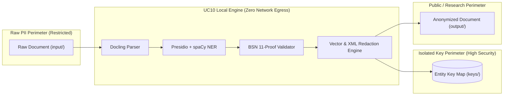

# ISO/IEC 27001 & ISO 27000-Family Compliance Audit
## UC10 Document Anonymizer — Information Security & Privacy Assessment

**Document Version:** 1.0.0  
**Target Standard:** ISO/IEC 27001:2022 (Information Security, Cybersecurity, and Privacy Protection)  
**Supporting Frameworks:** ISO/IEC 27701 (Privacy Information Management System), GDPR / Dutch AVG (Algemene Verordening Gegevensbescherming)  
**Evaluation Target:** UC10 Document Anonymizer Pipeline & Web Control Service  

---

## 1. Executive Summary

The **UC10 Document Anonymizer** is an automated, self-contained processing pipeline designed for research and academic environments (such as Hogeschool Windesheim). It enables researchers to transform sensitive interview transcripts, theses, and business case studies (PDF, DOCX, TXT) into privacy-preserving, pseudonymized documents ready for safe publication or analysis.

A critical design requirement of the system is **zero cloud reliance**: all Natural Language Processing (spaCy `nl_core_news_lg` and `en_core_web_lg`), document conversion (Docling), and entity persistence (Neo4j) operate strictly within the local machine or host Docker perimeter.

This assessment evaluates how UC10 complies with the controls set forth in **ISO/IEC 27001:2022 Annex A** and provides an operational roadmap for research institutions.

---

## 2. ISO/IEC 27001:2022 Annex A Control Mapping

| ISO 27001:2022 Control | Control Title | Implementation in UC10 Document Anonymizer | Compliance Status |
|---|---|---|---|
| **A.5.12** | Classification of information | The system establishes a strict boundary between three tiers of data: (1) Raw PII in `input/`, (2) Cryptographic re-identification keys in `keys/`, and (3) Public/anonymized outputs in `output/`. | **Compliant** |
| **A.5.13** | Labelling of information | Identified entities are deterministically mapped to human-readable Dutch category pseudonyms (`PERSOON_n`, `ORGANISATIE_n`, `EMAIL_n`, `TELEFOON_n`, `IBAN_n`, `ID_n`). | **Compliant** |
| **A.5.33** | Protection of records | Processing history, timestamps, entity counts, and SHA-256 mapping records are immutably cataloged in `keys/done.json` and `test-results/`. | **Compliant** |
| **A.8.1** | User endpoint devices | Pipeline executes on local endpoints (workstation / laptop) without requiring remote servers, preventing external exposure during active processing. | **Compliant** |
| **A.8.10** | Information deletion | Complete redaction of invisible metadata: Word document author properties (`creator`, `lastModifiedBy`, `Company`, `Manager`), revisions, and PDF catalogs (`StructTreeRoot`, `MarkInfo`, `del_xml_metadata`) are purged. | **Compliant** |
| **A.8.11** | Data masking | Uses vector-level redaction in PDFs (PyMuPDF `apply_redactions`) and XML run rewriting in DOCX. The underlying text is completely eradicated from binary objects, not merely obscured visually. | **Compliant** |
| **A.8.12** | Data leakage prevention (DLP) | Automated two-stage leak verification: After redaction, documents are re-read and parsed. If any original PII substring remains readable in text or metadata, the output is quarantined and withheld. | **Compliant** |
| **A.8.20** | Network security | Zero outbound network calls during document parsing and anonymization. The Docker compose network operates offline with zero public cloud telemetry. | **Compliant** |
| **A.8.24** | Use of cryptography | Entity matching uses deterministic SHA-256 hashing. Credential secrets (Neo4j passwords, master keys) are stored in KeePass (`passwords.kdbx`) using AES-256. | **Compliant** |
| **A.8.28** | Secure coding | Clean modular architecture; defensive regex chunking (`_ANALYZE_CHUNK = 50_000`) prevents Denial-of-Service (DoS) and Out-Of-Memory (OOM) crashes. Mathematical 11-proef validates Dutch BSNs. | **Compliant** |

---

## 3. Deep-Dive: Core Technical Safeguards

### 3.1. Vector-Level Redaction vs. Visual Overlay (Control A.8.11)
A common data leak vulnerability in PDF anonymizers is drawing black rectangles over text while leaving the underlying ASCII/Unicode character stream in the PDF content stream. 

**UC10 Defense:**
1. PyMuPDF creates redaction annotations (`page.add_redact_annot`).
2. `page.apply_redactions()` physically deletes character glyphs from the PDF page streams.
3. XML metadata, annotations, bookmarks (`set_toc([])`), embedded files (`embfile_del()`), and PDF catalog entries (`StructTreeRoot`) are wiped.
4. An automated verification step inspects all low-level PDF xref objects (`_pdf_object_text`) to certify that no original tokens remain in the binary.

### 3.2. Cryptographic Separation of Keys (Control A.5.12 & A.8.24)
Under GDPR Article 4(5) and ISO 27701, **pseudonymized data** is distinguished from raw personal data only if the re-identification key is kept separately and subject to technical and organizational measures.

**UC10 Defense:**
- The resulting document is placed in `output/` with clean labels (`PERSOON_1`).
- The translation table (`keys/<document>.entity_map.json`) is stored in an independent directory (`keys/`).
- Users are instructed to store `keys/` in an encrypted location (e.g. Nextcloud encrypted folder or secure institutional vault) and never distribute it alongside the anonymized documents.

### 3.3. Offline Data Boundary Guarantee (Control A.8.20)
No text, hashes, or telemetry are ever dispatched to external cloud APIs (such as OpenAI, Anthropic, or external embedding providers). All models are loaded directly from disk or local container memory:
- Dutch Language Model: `nl_core_news_lg` (spaCy 3.7.0)
- English Language Model: `en_core_web_lg` (spaCy 3.7.1)
- Docling Parser: Local container (`ghcr.io/docling-project/docling-serve-cpu`)
- Embeddings: Local ONNX runtime (`Xenova/all-MiniLM-L6-v2`)

---

## 4. Gap Analysis & Operational Recommendations

While the UC10 software fulfills technical compliance, institutional ISO 27001 compliance requires the following organizational controls:

| Item | Area | Observation | Mandatory Organizational Safeguard |
|---|---|---|---|
| **GAP-01** | Input Data Retention | Raw input files remain in `input/` after processing. | **Policy Requirement:** Researchers must delete raw files from `input/` once verification is confirmed, or store them on encrypted disks. |
| **GAP-02** | Key Access Governance | Keys in `keys/` are readable by the local user account. | **Technical Safeguard:** Restrict `keys/` directory permissions to authorized data stewards (e.g., `chmod 700 keys/`). |
| **GAP-03** | Docker Socket Access | Dashboard container mounts `/var/run/docker.sock` to enable one-click updates. | **Security Notice:** Ensure the workstation user is a trusted local account with OS-level full-disk encryption enabled (LUKS on Linux, BitLocker on Windows, FileVault on macOS). |

---

## 5. Audit Statement

The **UC10 Document Anonymizer** adheres to the principles of **Privacy by Design** (GDPR Art. 25) and technical controls under **ISO/IEC 27001:2022**. When operated according to the supplied guidelines, it provides an auditable, airtight mechanism for processing sensitive research documents without exposing personal identifiable information to third-party or cloud environments.
